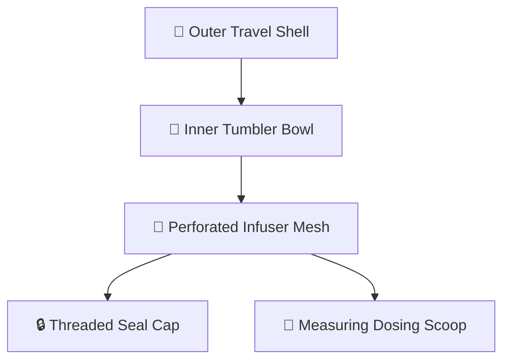

<div align="center">

# ☕ Parametric 3D CAD Travel Tea Infuser & Tumbler

**Parametric CAD design and automated tolerance verification for a compact travel tea infuser and tumbler implemented in OpenSCAD with Python exploded-view animation.**

[](https://openscad.org/)
[](https://www.python.org/)
[](https://en.wikipedia.org/wiki/3D_printing)
[](LICENSE)

[🇷🇺 Читать на русском](README.md) • [🇬🇧 Read in English](README.en.md)

---

</div>

## 📑 Table of Contents

1. [Engineering Concept & Requirements](#1-engineering-concept--requirements)
   * [1.1. Product Purpose](#11-product-purpose)
   * [1.2. Design Specifications](#12-design-specifications)
2. [Parametric Geometry & Tolerance Analysis](#2-parametric-geometry--tolerance-analysis)
   * [2.1. OpenSCAD Implementation (tea_infuser.scad)](#21-openscad-implementation-tea_infuserscad)
   * [2.2. Mechanical Clearance Verification (check_fit.py)](#22-mechanical-clearance-verification-check_fitpy)
   * [2.3. Assembly Exploded Animation (animate.py)](#23-assembly-exploded-animation-animatepy)
3. [Assembly Component Hierarchy](#3-assembly-component-hierarchy)
4. [Project Structure](#4-project-structure)
5. [Technology Stack](#5-technology-stack)
6. [Build & Export](#6-build--export)
7. [Author & Contacts](#7-author--contacts)

---

## 1. Engineering Concept & Requirements

### 1.1. Product Purpose
A portable travel tumbler integrating an internal brewing chamber (infuser mesh) and calibrated measuring scoop. Engineered for loose-leaf tea brewing during transit without thermal leakage or messy cleanup.

### 1.2. Design Specifications
* **Modular Stacking:** Matryoshka-style nested architecture — the inner chamber, lid, and scoop store compactly inside the hermetic outer travel casing.
* **3D Printing Tolerances:** Mechanical offsets customized for FDM/SLA desktop additive manufacturing taking into account thermal plastic shrinkage (PETG/PLA).

---

## 2. Parametric Geometry & Tolerance Analysis

### 2.1. OpenSCAD Implementation (`tea_infuser.scad`)
Entire geometry is procedurally defined through parametric variables:
* Wall radii, rib reinforcements, and thread pitches;
* Changing global diameter/height parameters automatically recalculates child part geometries without breaking assembly fits.

### 2.2. Mechanical Clearance Verification (`check_fit.py`)
Python inspection script evaluating spatial mesh clearances:
* Identifies boundary collision intersections between outer infuser mesh and inner tumbler vessel;
* Verifies strict 0.35 mm mechanical air gap tolerances for seamless rotation and assembly.

### 2.3. Assembly Exploded Animation (`animate.py`)
* Frame-by-frame exploded view generator;
* Visual kinematic inspection of deployment and closure sequences.

---

## 3. Assembly Component Hierarchy



---

## 4. Project Structure

```text
06-parametric-cad-tea-infuser/
├── scad/
│   └── tea_infuser.scad     # Parametric OpenSCAD CAD source
├── check_fit.py             # Mechanical fit and interference verification
├── animate.py               # Frame-by-frame assembly animator
├── export.py                # STL/GLB CAD compilation pipeline
├── export/                  # Compiled 3D meshes (STL) and visual renders
│   ├── bowl.stl             # Tumbler body
│   ├── case_body.stl        # Outer case
│   ├── case_cap.stl         # Case threaded cap
│   └── assembly.png         # Exploded render
├── requirements.txt         # Python package manifest
├── .gitignore               # Version control ignore rules
├── README.md                # Russian documentation
└── README.en.md             # English documentation
```

---

## 5. Technology Stack

* `OpenSCAD` (CSG parametric modeling)
* `Python 3.10+`
* `Trimesh` (3D geometry and interference analysis)
* `Matplotlib & Pillow` (render compilation)

---

## 6. Build & Export

```bash
git clone https://github.com/Andrew123485/parametric-cad-tea-infuser.git
cd parametric-cad-tea-infuser

python -m venv venv
.\venv\Scripts\activate
pip install -r requirements.txt

# Run tolerance verification
python check_fit.py

# Export STL meshes
python export.py
```

---

## 7. Author & Contacts

* **Author:** Andrei Vladimirov
* **Specialization:** Business Analyst / Fintech Developer
* **Telegram:** [@amorfatimementomoria](https://t.me/amorfatimementomoria)
* **GitHub:** [github.com/Andrew123485](https://github.com/Andrew123485)
