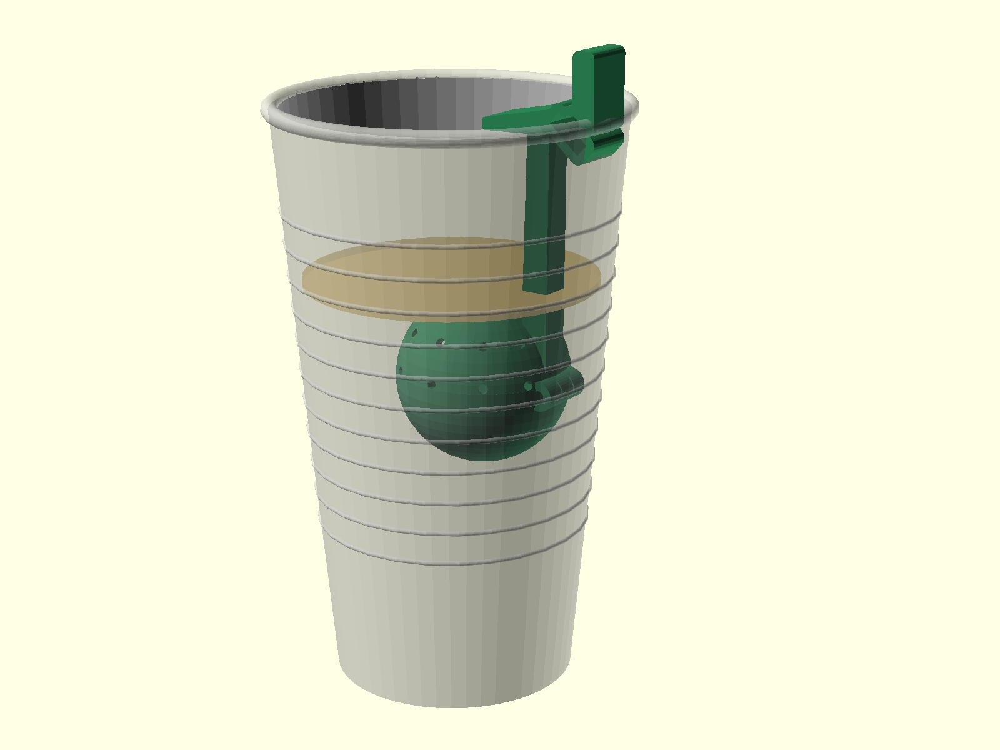
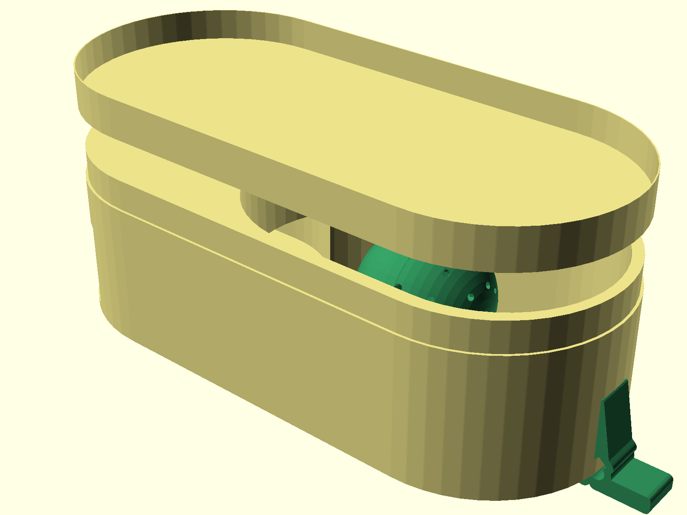
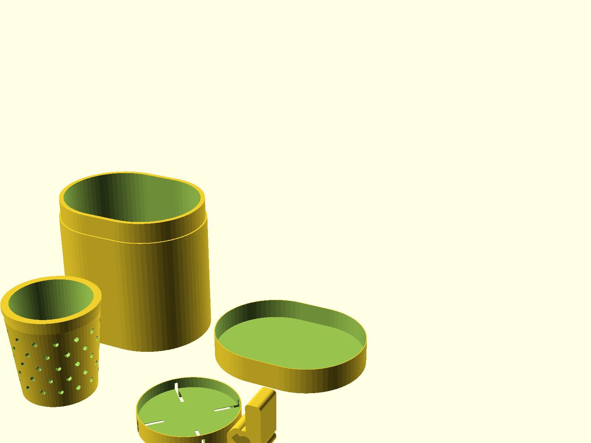
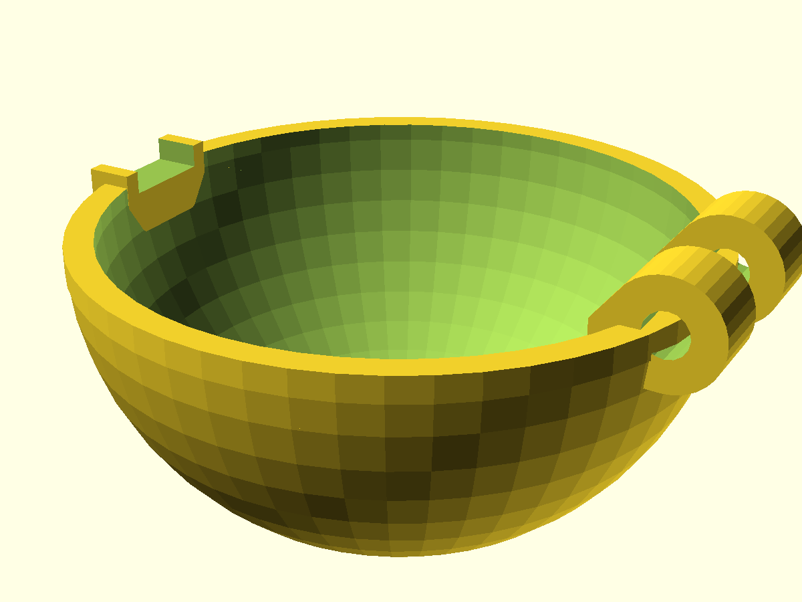
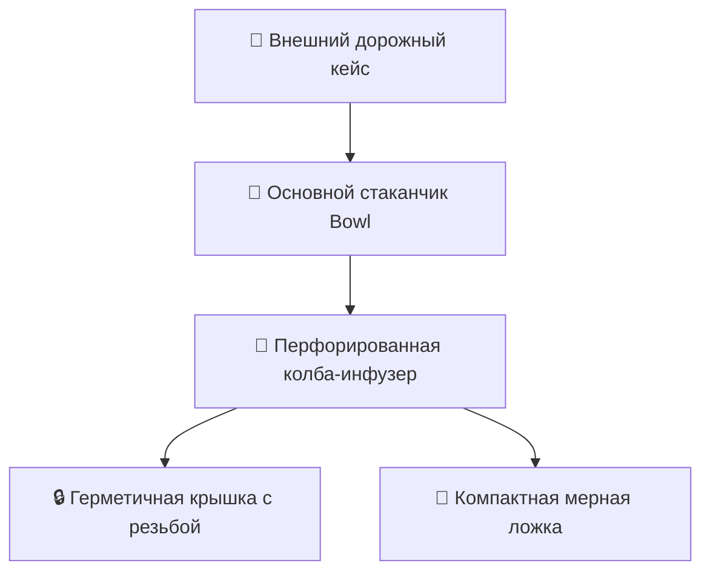

<div align="center">

# ☕ Parametric 3D CAD Travel Tea Infuser & Tumbler

**Параметрическое проектирование и автоматизированная проверка допусков компактного дорожного стаканчика-инфузера в OpenSCAD с Python-анимацией сборки.**

[](https://openscad.org/)
[](https://www.python.org/)
[](https://en.wikipedia.org/wiki/3D_printing)
[](LICENSE)

[🇷🇺 Читать на русском](README.md) • [🇬🇧 Read in English](README.en.md)

---

</div>

## 📑 Содержание

1. [Концепция инженерного проекта](#1-концепция-инженерного-проекта)
   * [1.1. Назначение изделия](#11-назначение-изделия)
   * [1.2. Требования к конструкции](#12-требования-к-конструкции)
2. [Параметрическая геометрия и допуски](#2-параметрическая-геометрия-и-допуски)
   * [2.1. OpenSCAD код (tea_infuser.scad)](#21-openscad-код-tea_infuserscad)
   * [2.2. Верификация посадок и зазоров (check_fit.py)](#22-верификация-посадок-и-зазоров-check_fitpy)
   * [2.3. Покадровая анимация сборки (animate.py)](#23-покадровая-анимация-сборки-animatepy)
3. [Спецификация деталей сборки](#3-спецификация-деталей-сборки)
4. [Структура репозитория](#4-структура-репозитория)
5. [Стек технологий](#5-стек-технологий)
6. [Сборка и экспорт](#6-сборка-и-экспорт)
7. [Автор и контакты](#7-автор-и-контакты)

---

## 1. Концепция инженерного проекта

### 1.1. Назначение изделия
Компактный многофункциональный дорожный стаканчик с интегрированным чайным инфузером (заварочной колбой) и мерной ложкой. Разработан для удобного заваривания листового чая в поездках без протечек и с возможностью быстрого извлечения заварки.

### 1.2. Требования к конструкции
* **Модульность:** Быстроразборная конструкция типа «матрёшка» — все внутренние элементы (колба, сито, ложка) компактно складываются в основной герметичный кейс.
* **Допуски под FDM/SLA 3D-печать:** Зазоры на сопряжение резьбовых и конических посадок с учетом температурной усадки пластика (PETG/PLA).

---

## 2. 📸 Визуальная галерея CAD-модели и 3D-сборки

<div align="center">

| Полная 3D-сборка инфузера (Assembly CAD) | Раскрытый дорожный комплект (Kit Open) |
|:---:|:---:|
|  |  |

| Подготовка деталей к 3D-печати (Print Plate) | Детализация стакана и сита (Bowl & Infuser) |
|:---:|:---:|
|  |  |

</div>

---

## 3. Параметрическая геометрия и допуски

### 2.1. OpenSCAD код (`tea_infuser.scad`)
Вся геометрия изделия вычислена математически через формулы с управляющими глобальными переменными:
* Радиусы стенок, толщины ребер жесткости;
* Параметры резьбы и перфорации сита;
* При изменении высоты или диаметра кружки все внутренние элементы автоматически масштабируются без нарушения кинематических связей.

### 2.2. Верификация посадок и зазоров (`check_fit.py`)
Python-скрипт численной проверки сопряжения:
* Проверяет коллизии между наружным контуром сита и внутренним диаметром стакана;
* Рассчитывает минимальный воздушный зазор (clearance) для свободного хода без люфта (номинальный зазор: 0.35 мм).

### 2.3. Покадровая анимация сборки (`animate.py`)
* Генерация взрыв-схемы (Exploded View);
* Рендеринг кадров раскрытия и закрытия дорожного кейса для визуальной оценки эргономики.

---

## 3. Спецификация деталей сборки



---

## 4. Структура репозитория

```text
06-parametric-cad-tea-infuser/
├── scad/
│   └── tea_infuser.scad     # Параметрический CAD-исходник изделия в OpenSCAD
├── check_fit.py             # Анализ зазоров и верификация посадок
├── animate.py               # Генератор покадровой анимации сборки
├── export.py                # Пайплайн экспорта геометрии в STL/GLB
├── export/                  # Готовые 3D-модели (STL) и рендеры
│   ├── bowl.stl             # Основной стакан
│   ├── case_body.stl        # Корпус кейса
│   ├── case_cap.stl         # Крышка кейса
│   └── assembly.png         # Рендер сборки
├── requirements.txt         # Зависимости Python
├── .gitignore               # Исключения версионного контроля
├── README.md                # Документация на русском
└── README.en.md             # English documentation
```

---

## 5. Стек технологий

* `OpenSCAD` (CSG геометрическое моделирование)
* `Python 3.10+`
* `Trimesh` (анализ 3D-сеток и коллизий)
* `Matplotlib & Pillow` (генерация превью и раскадровки)

---

## 6. Сборка и экспорт

```bash
git clone https://github.com/Andrew123485/parametric-cad-tea-infuser.git
cd parametric-cad-tea-infuser

python -m venv venv
.\venv\Scripts\activate
pip install -r requirements.txt

# 1. Запуск проверки допусков
python check_fit.py

# 2. Экспорт STL-моделей
python export.py
```

---

## 7. Автор и контакты

* **Автор:** Владимиров Андрей Георгиевич
* **Специализация:** Бизнес-аналитик / Финтех-разработчик
* **Telegram:** [@amorfatimementomoria](https://t.me/amorfatimementomoria)
* **GitHub:** [github.com/Andrew123485](https://github.com/Andrew123485)
